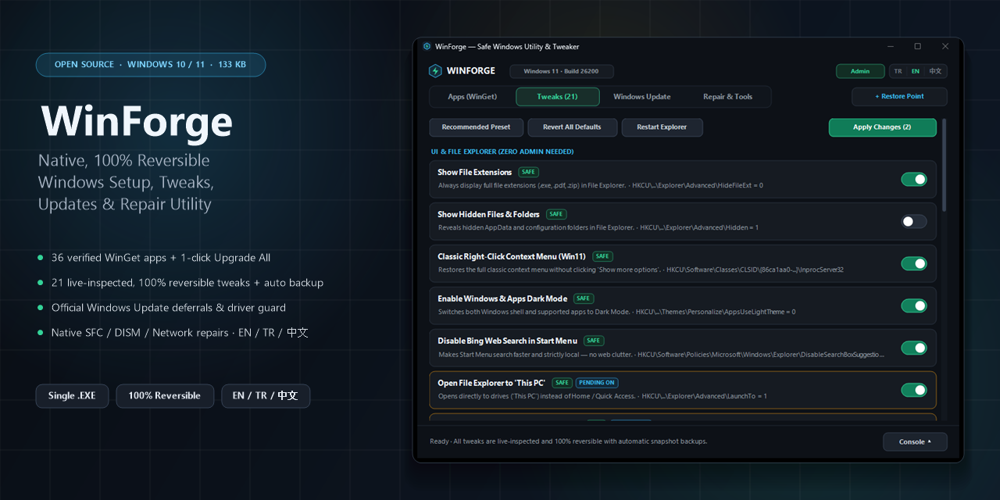
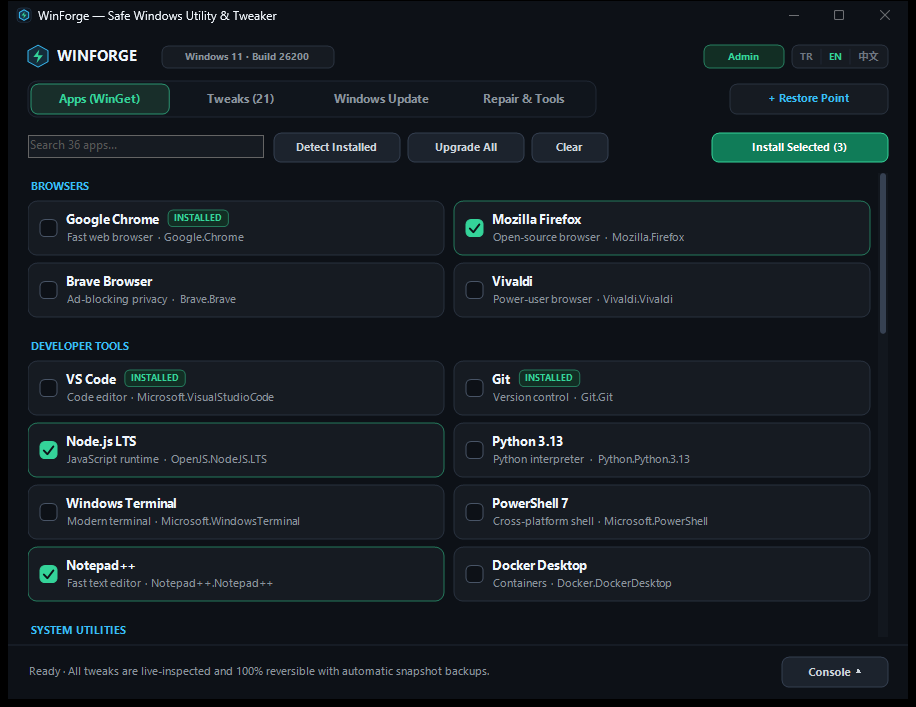
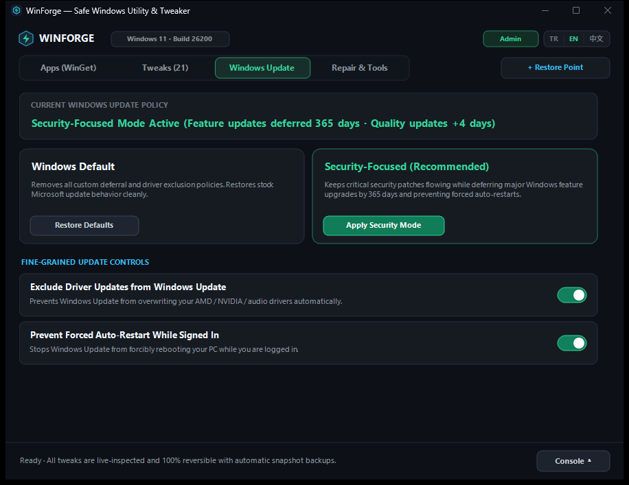
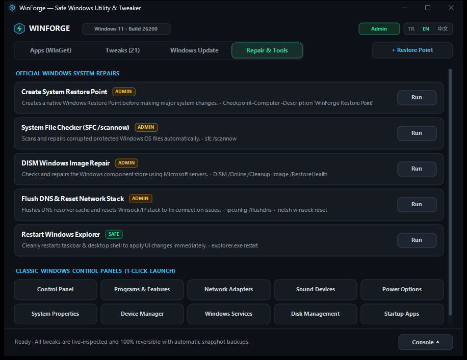
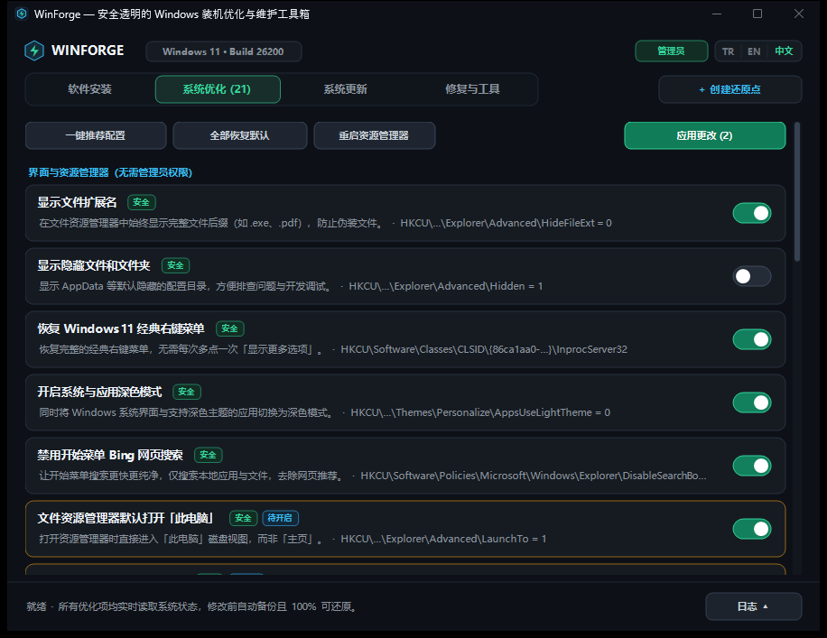
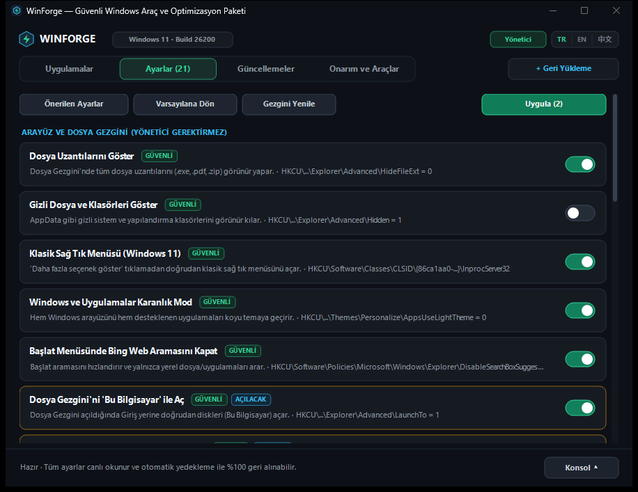

<p align="center">
  
</p>

<h1 align="center">WinForge</h1>

<p align="center">
  <strong>A tiny (~133 KB), zero-dependency native Windows 10/11 utility inspired by Chris Titus WinUtil — featuring verified WinGet batch app installs, 21 live-inspected reversible tweaks with auto-backup, official Windows Update policies, and built-in system repairs.</strong>
</p>

<p align="center">
  
  
  
  
  <a href="https://linux.do"></a>
</p>

<p align="center">
  <b>English</b> &nbsp;·&nbsp; <a href="README.zh-CN.md"><b>简体中文</b></a> &nbsp;·&nbsp; <a href="#türkçe"><b>Türkçe</b></a> &nbsp;·&nbsp; <a href="https://github.com/rodvay/WinForge/releases/latest"><b>Download Latest Release</b></a>
</p>

---

## Why WinForge?

- **Native Compiled `.EXE` — No PowerShell ExecutionPolicy Errors:** Launches in <100ms with zero script download, zero PowerShell profile blocks, and zero runtime bloat.
- **100% Live-Inspected & 100% Reversible Tweaks:** Reads real live registry/system values on launch, displays the exact target Registry key on every toggle, automatically saves a timestamped backup snapshot (`%APPDATA%\WinForge\backups\`) before every apply, and offers 1-click **Revert All Defaults**.
- **Zero Dangerous / System-Breaking Hacks:** Never disables Windows Defender, never nukes Microsoft Store or WinSxS, and never runs risky registry cleaners.
- **Smart OS Language Auto-Detection (`EN` / `TR` / `简体中文`):** Launches automatically in Turkish on Turkish Windows, Simplified Chinese on Chinese Windows, and English everywhere else — with a live **`TR | EN | 中文`** switcher in the top bar.

---

## Screenshots

<table>
  <tr>
    <td align="center" width="50%">
      <br />
      <sub><b>Apps Tab</b> — 36 verified WinGet packages, live search, detect installed & 1-click Upgrade All</sub>
    </td>
    <td align="center" width="50%">
      <br />
      <sub><b>Tweaks Tab</b> — 21 live-inspected reversible UI, Privacy & Performance tweaks</sub>
    </td>
  </tr>
  <tr>
    <td align="center" width="50%">
      <br />
      <sub><b>Windows Update Tab</b> — Security-focused deferral (365d feature / 4d quality) & driver guard</sub>
    </td>
    <td align="center" width="50%">
      <br />
      <sub><b>Repair & Tools Tab</b> — Restore Point, SFC, DISM, DNS/Winsock reset & 10 classic panels</sub>
    </td>
  </tr>
</table>

<table>
  <tr>
    <td align="center" width="50%">
      <br />
      <sub><b>简体中文界面</b> — Native Microsoft YaHei UI localization</sub>
    </td>
    <td align="center" width="50%">
      <br />
      <sub><b>Türkçe Arayüz</b> — Otomatik dil algılama & anlık geçiş</sub>
    </td>
  </tr>
</table>

---

## Modules Overview

### 1. Apps (`WinGet`)
- **36 live-verified official WinGet package IDs** across 6 categories (*Browsers*, *Developer Tools*, *System Utilities*, *Media & Creative*, *Chat & Security*, *Gaming & Runtimes*).
- Live search bar, **Detect Installed** scanner, silent batch installation with streaming console output + **Stop** cancellation, and 1-click **Upgrade All (`winget upgrade --all`)**.

### 2. Tweaks (21 Reversible Tweaks)
- **UI & File Explorer (10 HKCU tweaks — zero Admin needed):** Show file extensions, show hidden files, restore Windows 11 classic right-click context menu, Dark Mode, disable Start Menu Bing web search, open Explorer to "This PC", enable Taskbar right-click "End Task", align taskbar left, taskbar clock seconds, disable Start & lock screen promo tips.
- **Privacy & Telemetry (6 tweaks):** Disable Advertising ID, disable tailored diagnostic tips, hide taskbar Copilot button, reduce telemetry to required minimum (`AllowTelemetry = 1`), disable Activity History, block auto-installed consumer promo apps.
- **Performance & Power (5 tweaks):** Enable Game Mode, disable mouse acceleration (1:1 raw aim), Hardware-Accelerated GPU Scheduling (HAGS), High Performance power plan, disable hibernation (`hiberfil.sys`).
- Includes **Recommended Preset**, **Revert All Defaults**, **Restart Explorer**, and automatic snapshot backup before applying.

### 3. Windows Update Policies
- **Windows Default:** Removes all custom update policies and restores stock Microsoft behavior.
- **Security-Focused (Recommended):** Keeps security patches active while deferring major feature upgrades by 365 days & quality updates by 4 days, plus prevents forced auto-restarts.
- **Independent Toggles:** Exclude hardware drivers from Windows Update (`ExcludeWUDriversInQualityUpdate`) and prevent forced restarts while signed in.

### 4. Repair & Tools
- Official Microsoft repairs with live console streaming: **Create System Restore Point**, **`sfc /scannow`**, **`DISM /RestoreHealth`**, **DNS Flush & Winsock Reset**, and **Restart Windows Explorer**.
- 10 one-click classic panel launchers (*Control Panel*, *Programs & Features*, *Network Adapters*, *Sound Devices*, *Power Options*, *System Properties*, *Device Manager*, *Services*, *Disk Management*, *Startup Apps*).

---

## Download & Quick Start

1. Download **`WinForge.exe`** (~133 KB) from the **[Releases](https://github.com/rodvay/WinForge/releases/latest)** page.
2. Double-click to run — launches immediately without forcing UAC. Click **Admin ↗** in the top bar only when you want to apply HKLM tweaks, Windows Update policies, or SFC/DISM repairs.

## Building from Source

Requires only Windows 10 or 11 (uses built-in `.NET Framework 4.x` `csc.exe`):

```bat
git clone https://github.com/rodvay/WinForge.git
cd WinForge
build.bat
```

---

<a id="türkçe"></a>

## Türkçe Özet

**WinForge**, Chris Titus WinUtil konseptinde geliştirilmiş, ancak PowerShell script hataları yaşamadan tek dosya (`~133 KB`) olarak anında çalışan, **%100 geri alınabilir** açık kaynaklı Windows 10/11 yönetim ve optimizasyon aracıdır.

- **4 Ana Sekme:** Doğrulanmış 36 uygulamalı **WinGet Toplu Kurulum & Güncelleme**, canlı durum okuyan + otomatik yedekleyen **21 Geri Alınabilir Sistem Ayarı**, resmi **Windows Update Erteleme & Sürücü Koruması** ve **SFC / DISM / Ağ Onarımı + Klasik Denetim Masaları**.
- **Otomatik Dil Algılama:** Türkçe Windows'ta Türkçe, Çince Windows'ta Basitleştirilmiş Çince, diğer dillerde İngilizce başlar (`TR | EN | 中文`).
- **İndirme:** **[Releases](https://github.com/rodvay/WinForge/releases/latest)** sayfasından `WinForge.exe` dosyasını indirip çalıştırabilirsiniz.

> 简体中文完整文档请查看 **[README.zh-CN.md](README.zh-CN.md)**。

---

## Community & Links

- Friendly community link & discussion: **[LINUX DO](https://linux.do)** — Thank you to the LINUX DO open-source community for the feedback and support!

## License

Licensed under the **MIT License** — see [LICENSE](LICENSE) for details.
