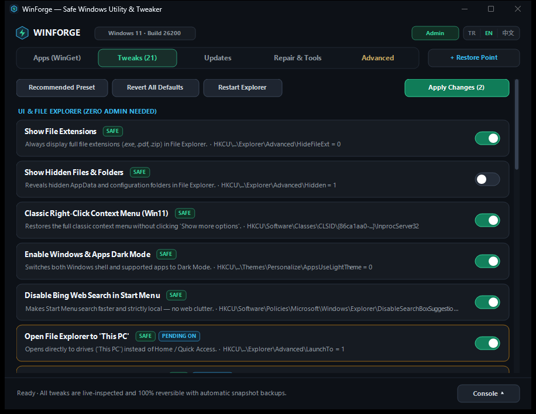
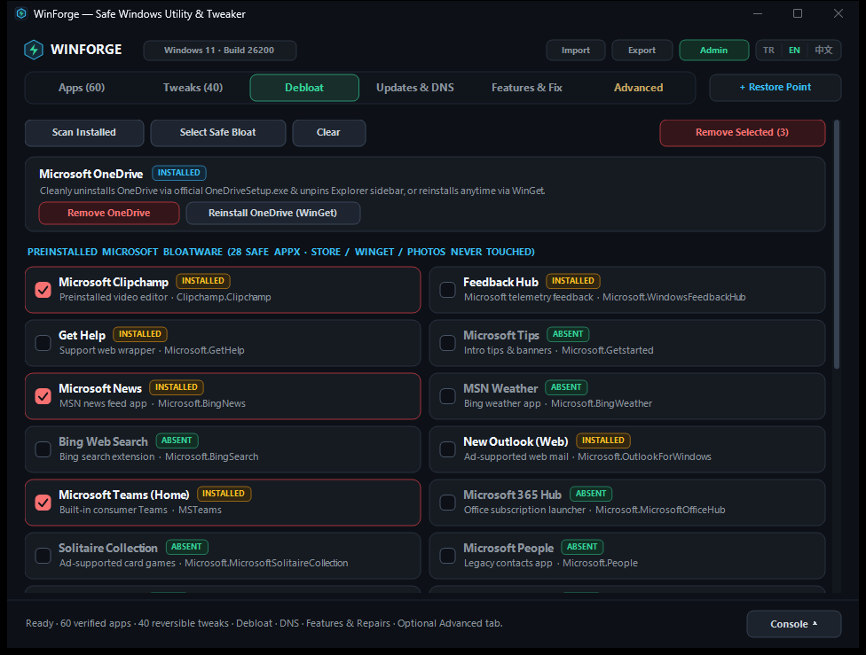
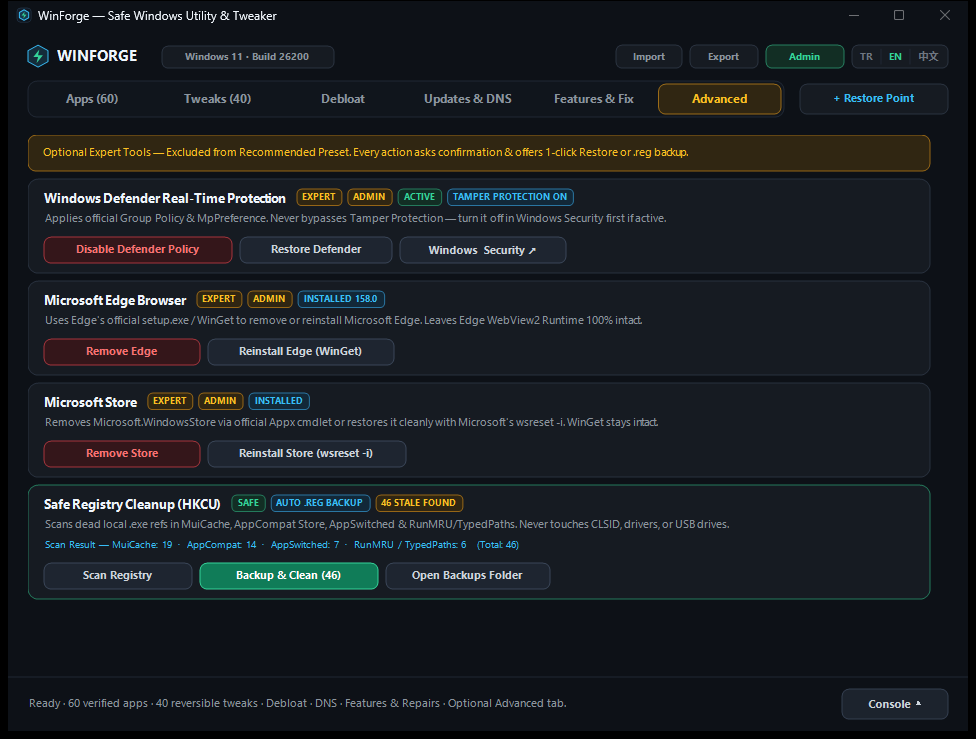
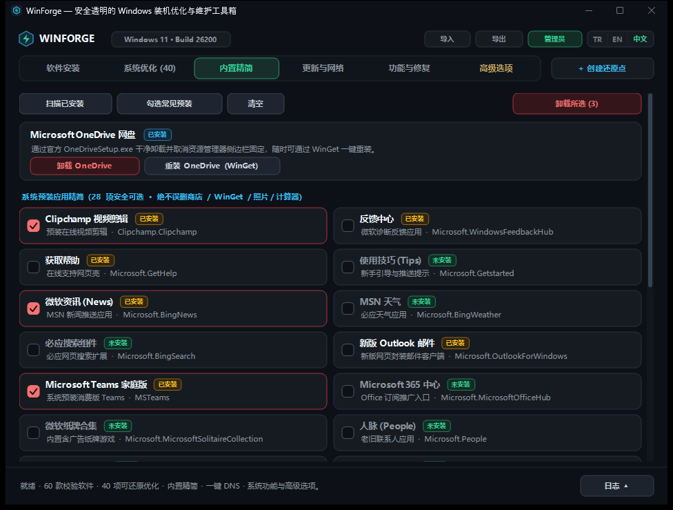

<p align="center">
  
</p>

<h1 align="center">WinForge</h1>

<p align="center">
  <strong>A tiny (~270 KB), zero-dependency, 100% reversible native Windows 10/11 utility with full Chris Titus WinUtil parity and beyond — featuring 60 verified WinGet apps, 40 live tweaks (Desktop/Laptop presets + JSON Export/Import), 28-app Bloatware & OneDrive Debloater, Windows Update & 1-click DNS Switcher, Windows Optional Features & Repairs, and an opt-in Advanced tab.</strong>
</p>

<p align="center">
  
  
  
  
  <a href="https://linux.do"></a>
</p>

<p align="center">
  <b>English</b> &nbsp;·&nbsp; <a href="README.zh-CN.md"><b>简体中文</b></a> &nbsp;·&nbsp; <a href="#türkçe"><b>Türkçe</b></a> &nbsp;·&nbsp; <a href="https://github.com/rodvay/WinForge/releases/latest"><b>Download Latest Release (v2.0.4)</b></a>
</p>

---

## Why WinForge v2.0?

- **Native Compiled Single `.EXE` (~270 KB):** Launches in <100ms with zero PowerShell ExecutionPolicy blocks, zero online script fetches, and zero external runtimes.
- **Full 6-Module Coverage — 100% Reversible:** Covers every major workflow from Chris Titus Tech's WinUtil (`Apps`, `Tweaks`, `Debloat`, `Updates & DNS`, `Features & Repairs`, `Advanced`) with live system detection, automatic pre-apply backups (`%APPDATA%\WinForge\backups\`), and 1-click JSON Profile **Import / Export**.
- **Desktop & Laptop Presets + Safe Services Manualization:** Laptop preset preserves Hibernation & battery sleep; `Services -> Manual` switches 16 safe idle services from Auto to Manual while saving every service's original `Start` value for 100% accurate restore.
- **Smart OS Language Auto-Detection (`EN` / `TR` / `简体中文`):** Auto-launches in Turkish on Turkish Windows, Simplified Chinese on Chinese Windows, and English everywhere else — with a live **`TR | EN | 中文`** switcher in the top bar.

---

## Screenshots

<table>
  <tr>
    <td align="center" width="50%">
      <br />
      <sub><b>Apps Tab (60)</b> — 60 live-verified WinGet packages across 7 groups, live search, Detect Installed & Upgrade All</sub>
    </td>
    <td align="center" width="50%">
      <br />
      <sub><b>Tweaks Tab (40)</b> — Desktop/Laptop presets, Services Manual, Ultimate Perf, JSON Import/Export</sub>
    </td>
  </tr>
  <tr>
    <td align="center" width="50%">
      <br />
      <sub><b>Debloat Tab</b> — 28 safe preinstalled Appx scanner & remover + OneDrive Remove/Reinstall</sub>
    </td>
    <td align="center" width="50%">
      <br />
      <sub><b>Updates & DNS Tab</b> — Security deferral (+365d/+4d), driver guard & 7-preset 1-Click DNS Switcher</sub>
    </td>
  </tr>
  <tr>
    <td align="center" width="50%">
      <br />
      <sub><b>Features & Fix Tab</b> — 8 official repairs (incl. Reset WU & Repair WinGet), 7 Windows Features & 15 classic panels</sub>
    </td>
    <td align="center" width="50%">
      <br />
      <sub><b>Advanced Tab (Optional)</b> — Defender policy, Edge & Store remove/reinstall, auto `.reg` backup cleanup</sub>
    </td>
  </tr>
</table>

<table>
  <tr>
    <td align="center" width="50%">
      <br />
      <sub><b>简体中文界面</b> — Native Microsoft YaHei UI localization across all 6 tabs</sub>
    </td>
    <td align="center" width="50%">
      <br />
      <sub><b>Türkçe Arayüz</b> — Masaüstü/Dizüstü profilleri & otomatik dil algılama</sub>
    </td>
  </tr>
</table>

---

## All 6 Modules

### 1. Apps (`WinGet` — 60 Live-Verified Packages)
- 7 groups: *Browsers (7)*, *Developer Tools (16)*, *System Utilities (13)*, *Media & Creative (7)*, *Productivity & Docs (4)*, *Chat, Security & VPN (8)*, *Gaming & Runtimes (5)*.
- Live search bar, **Detect Installed**, silent batch install with real-time console & **Stop**, 1-click **Upgrade All**, plus top-bar **Import / Export JSON** profile support.

### 2. Tweaks (40 Live-Inspected, 100% Reversible Tweaks)
- **Desktop Preset** & **Laptop Preset** (Laptop preserves Hibernation & battery sleep) + **Revert All Defaults** + **Restart Explorer**.
- **UI & File Explorer (16 HKCU tweaks — zero Admin):** File extensions, hidden files, Win11 classic context menu, Dark Mode, disable Bing Start search, open Explorer to This PC, taskbar End Task, taskbar left align, taskbar seconds, disable Start/lock ads, disable Sticky Keys, NumLock on startup, always show scrollbars, hide Task View, hide Settings Home, Visual Effects Best Performance (keeps smooth ClearType fonts).
- **Privacy, Telemetry & Policies (12 tweaks):** Advertising ID, tailored diagnostic tips, taskbar Copilot button, telemetry minimum (`AllowTelemetry=1`), Activity History, block consumer promo apps, disable Widgets/News, disable location tracking, disable Delivery Optimization (P2P updates), disable Copilot & AI Recall policy, non-destructive Microsoft Edge debloat policy, disable UWP background apps.
- **Performance, Services & System (12 tweaks):** Game Mode, 1:1 mouse acceleration off, HAGS, High Performance power plan, Ultimate Performance power plan, disable Hibernation (Desktop), **Set 16 Safe Non-Essential Services to Manual** (with exact original `Start` backup & 100% restore), NTFS Long File Paths (>260 chars), Verbose Boot & Detailed BSoD, Prefer IPv4 (`0x20`), disable Teredo policy, UTC Hardware Clock (Linux dual-boot).

### 3. Debloat (28 Safe Preinstalled Appx + OneDrive)
- Live scans which of the 28 preinstalled Microsoft bloatware apps (`Clipchamp`, `Feedback Hub`, `Get Help`, `Bing News/Weather/Search`, `New Outlook`, `Teams Home`, `Solitaire`, `Power Automate`, `Dev Home`, `Quick Assist`, `Xbox` overlays, etc.) are installed on your PC — **never** touches Store, WinGet, Calculator, Photos, Terminal, or Security.
- Dedicated **Microsoft OneDrive** card: official `OneDriveSetup.exe /uninstall` + Explorer sidebar unpin, with 1-click **Reinstall OneDrive (`winget`)**.

### 4. Updates & DNS
- **Windows Update Policies:** `Windows Default` vs `Security-Focused` (365-day feature / 4-day quality deferral), independent `Exclude Driver Updates` and `Prevent Forced Auto-Restart` toggles.
- **1-Click DNS Switcher:** Live physical adapter & current DNS readout + 7 presets (`DHCP Default`, `Cloudflare 1.1.1.1`, `Cloudflare Malware 1.1.1.2`, `Google 8.8.8.8`, `Quad9 9.9.9.9`, `AdGuard Ad-Block 94.140.14.14`, `OpenDNS 208.67.222.222`) with automatic DNS flush.

### 5. Features & Fix
- **8 Official Repairs:** Create System Restore Point, `sfc /scannow`, `DISM /RestoreHealth`, **Reset Windows Update Components**, Flush DNS & Reset Network Stack, **Repair / Re-Register WinGet**, **Sync System Clock (NTP)**, Restart Windows Explorer.
- **7 Windows Optional Features (1-Click Enable / Disable):** WSL, Hyper-V, Windows Sandbox, `.NET Framework 3.5`, NFS Client, OpenSSH Server, Legacy F8 Boot Recovery Menu.
- **15 Classic Windows Control Panels:** Control Panel, Programs & Features, Network Adapters, Sound Devices, Power Options, System Properties, Device Manager, Windows Services, Disk Management, Startup Apps, Windows Firewall, Computer Management, Mouse Properties, Time & Date, System Restore UI.

### 6. Advanced (Optional Expert Tools — Always Opt-In & Reversible)
- **Windows Defender Real-Time Policy:** Live Tamper Protection detection (never bypasses security boundaries) + **Windows Security ↗** shortcut + 1-click **Restore Defender**.
- **Microsoft Edge Browser:** Official remove & 1-click WinGet reinstall — leaves **Edge WebView2 Runtime** 100% intact.
- **Microsoft Store:** Official Appx remove & 1-click **`wsreset -i`** reinstall — leaves **WinGet** intact.
- **Safe Registry Cleanup (`HKCU`, Auto `.reg` Backup):** Read-only scanner for dead fixed-drive `.exe` references (`MuiCache`, `AppCompatFlags`, `FeatureUsage\AppSwitched`) & `RunMRU / TypedPaths` history; exports a double-click restorable UTF-16 LE `.reg` backup before cleaning a single value.

---

## Download & Building from Source

1. Download **`WinForge.exe`** (~270 KB) from **[Releases](https://github.com/rodvay/WinForge/releases/latest)** and double-click to run.
2. Or compile from source in 1 second on any Windows 10/11 PC (uses inbox `.NET Framework 4.x` `csc.exe`, zero SDK required):

```bat
git clone https://github.com/rodvay/WinForge.git
cd WinForge
build.bat
```

---

<a id="türkçe"></a>

## Türkçe Özet

**WinForge v2.0**, Chris Titus Tech WinUtil'in tüm işlevlerini tek dosya (`~270 KB`), sıfır bağımlılık, sıfır PowerShell hatası ve **%100 geri alınabilir** yerli `.EXE` mimarisiyle birleştiren açık kaynaklı Windows 10/11 yönetim paketidir:

- **6 Tam Modül:**
  1. **Uygulamalar (`60 WinGet`):** Canlı doğrulamalı 60 uygulama, anlık arama, kurulu tarama, toplu kurulum ve tek tık güncelleme + üst barda **JSON İçe / Dışa Aktar**.
  2. **Ayarlar (`40 Ayar`):** Masaüstü ve Dizüstü (pil/uyku korumalı) hazır profilleri, 16 güvenli Windows servisini yedekli "Manuel"e çekme, Nihai Performans, Edge sadeleştirme, Widgets/AI/P2P kapatma, uzun dosya yolu, UTC saat ve tek tık **Varsayılana Dön**.
  3. **Bloatware (`Debloat`):** 28 önyüklü Microsoft Appx uygulamasını canlı tarayıp kaldırma + **Microsoft OneDrive** kaldırma / geri kurma.
  4. **Güncelleme & DNS:** Resmi Grup İlkesi güncelleme erteleme (+365g/+4g), sürücü koruması + 7 hazır profilli **Tek Tık DNS Değiştirici** (`Cloudflare`, `Google`, `Quad9`, `AdGuard`, `OpenDNS`, `DHCP`).
  5. **Özellikler & Onarım:** 8 resmi onarım (`SFC`, `DISM`, `Windows Update Sıfırla`, `WinGet Onar`, `NTP Saat`, `Ağ Sıfırla`, `Geri Yükleme Noktası`), 7 Windows Opsiyonel Özelliği (`WSL`, `Hyper-V`, `Sandbox`, `.NET 3.5`, `NFS`, `OpenSSH`, `F8 Menü`) ve 15 klasik Denetim Masası kısayolu.
  6. **Gelişmiş (Opsiyonel):** Onay kutulu ve tek tık geri alınabilir Defender politikası, WebView2'yi koruyan Edge kaldırma/kurma, WinGet'i koruyan Store kaldırma/kurma ve otomatik `.reg` yedekli Güvenli Kayıt Defteri Temizliği.
- **Otomatik 3 Dil (`TR | EN | 中文`):** Türkçe Windows'ta Türkçe, Çince Windows'ta Basitleştirilmiş Çince, diğer dillerde İngilizce başlar.

> 简体中文完整文档请查看 **[README.zh-CN.md](README.zh-CN.md)**。

---

## Community & Links

- Friendly community link & discussion: **[LINUX DO](https://linux.do)** — Thank you to the LINUX DO open-source community for the feedback and support!

## License

Licensed under the **MIT License** — see [LICENSE](LICENSE) for details.
