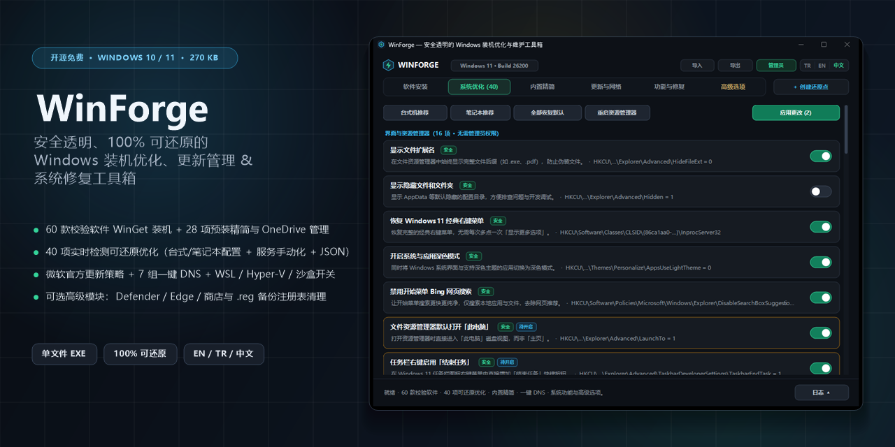
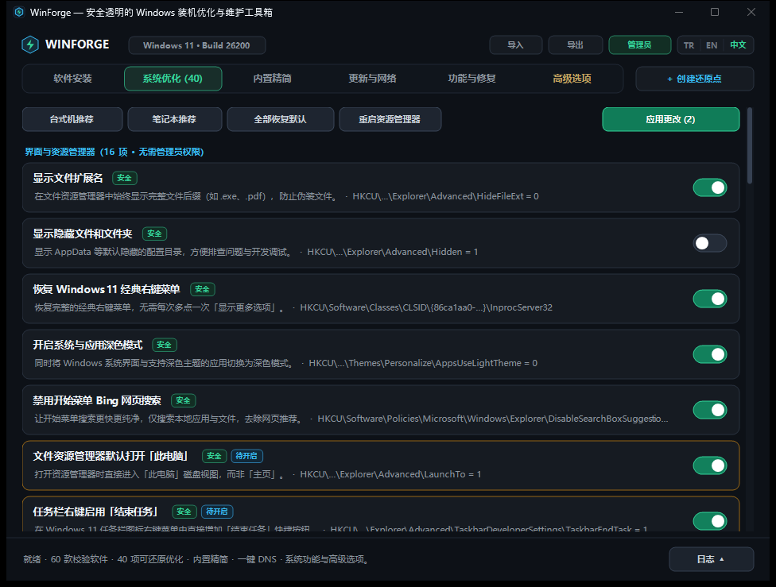
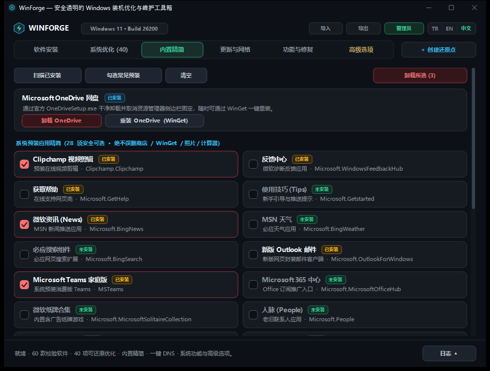
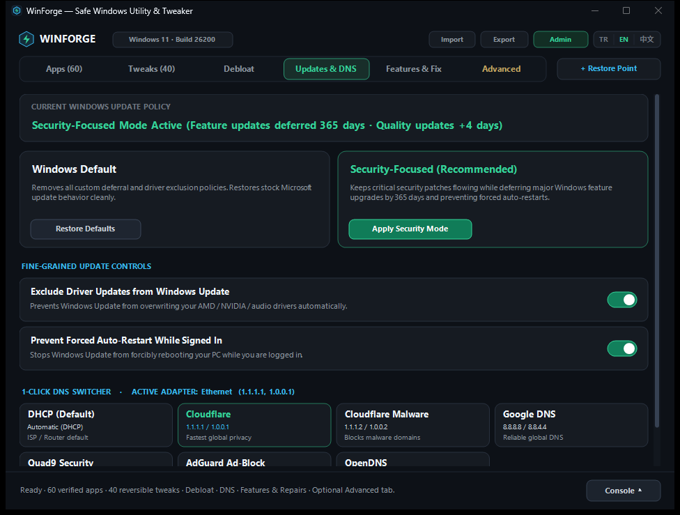
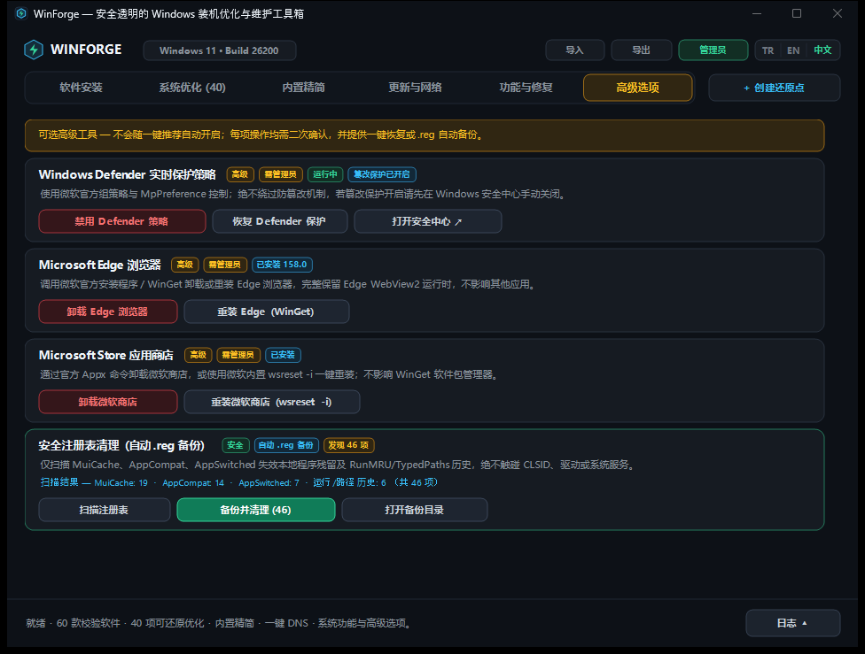

<p align="center">
  
</p>

<h1 align="center">WinForge v2.0 — Windows 装机优化与维护工具箱</h1>

<p align="center">
  <strong>仅约 270 KB、单文件免安装的原生 Windows 10/11 全功能工具箱（完整对标并超越 Chris Titus WinUtil）：集 60 款校验软件 WinGet 装机、40 项实时可还原系统优化（台式/笔记本配置 + 服务手动化 + JSON 迁移）、28 项预装精简与 OneDrive 管理、更新策略与一键 DNS、Windows 可选功能与官方修复、以及可选「高级选项」于一体。</strong>
</p>

<p align="center">
  
  
  
  
  <a href="https://linux.do"></a>
</p>

<p align="center">
  <a href="README.md"><b>English</b></a> &nbsp;·&nbsp; <b>简体中文</b> &nbsp;·&nbsp; <a href="README.md#türkçe"><b>Türkçe</b></a> &nbsp;·&nbsp; <a href="https://github.com/rodvay/WinForge/releases/latest"><b>下载最新版本 (v2.0.0)</b></a>
</p>

---

## 核心优势

- **原生单文件 EXE（~270 KB）**：零 PowerShell 执行策略报错、零在线脚本拉取失败、无需安装任何运行库，双击 <100ms 启动。
- **六大完整模块，全项实时检测且 100% 可还原**：修改前自动保存快照备份至 `%APPDATA%\WinForge\backups\`，支持 **台式机 / 笔记本双推荐预设** 与 **JSON 配置一键导出/导入**（重装系统 1 秒复原配置）。
- **系统语言智能自动适配**：中文 Windows 自动以**简体中文**启动，土耳其语系统自动以土耳其语启动，其余语言默认英文，右上角 **`TR | EN | 中文`** 可随时切换。

---

## 六大功能模块

### 1. 软件安装（WinGet · 60 款全量实测校验包）
- 覆盖 7 大分类：浏览器 (7)、开发工具 (16)、系统工具 (13)、影音创作 (7)、办公文档 (4)、通讯/安全/VPN (8)、游戏与运行库 (5)。
- 支持实时搜索过滤、检测本机已安装软件、静默批量安装（带流式日志与中断）以及一键 **全部升级 (`winget upgrade --all`)**。

### 2. 系统优化（40 项可还原开关 + 双预设 + JSON 导入导出）
- **界面与资源管理器（16 项 HKCU，无需管理员）**：文件扩展名、隐藏文件、Win11 经典右键菜单、深色模式、关闭开始菜单 Bing 搜索、默认打开「此电脑」、任务栏右键结束任务、任务栏左对齐、任务栏秒数、关闭推荐广告、关闭粘滞键弹窗、开机自动 NumLock、始终显示滚动条、隐藏任务视图、隐藏设置推荐主页、最佳性能视觉效果（保留平滑字体）。
- **隐私、遥测与策略（12 项）**：广告 ID、诊断个性化提示、任务栏 Copilot 按钮、遥测最低级 (`AllowTelemetry = 1`)、活动历史记录、阻止静默推广应用、关闭小组件资讯流、关闭定位追踪、关闭 P2P 更新上传（传递优化）、禁用 Copilot / AI 回顾策略、无损 Edge 后台与侧边栏精简策略、禁用 UWP 后台运行。
- **性能、服务手动化与系统（12 项）**：游戏模式、1:1 关闭鼠标加速、HAGS 硬件 GPU 调度、高性能与「卓越性能」电源方案、台式机关闭休眠、**16 项非核心服务安全转为「手动」（自动备份原状态可 100% 还原）**、NTFS 长路径 (>260 字符)、详细开机/蓝屏参数、优先 IPv4 (`0x20`)、禁用 Teredo、UTC 硬件时钟（解决 Linux 双系统时间偏差）。

### 3. 内置精简（28 项预装 Appx & OneDrive 管理）
- 自动扫描本机已安装的 28 项常见系统预装应用（Clipchamp、反馈中心、获取帮助、MSN 资讯/天气、新版 Outlook、消费版 Teams、纸牌合集、Power Automate、Dev Home、快速助手、Xbox 覆盖层等），支持勾选移除（**绝不误删微软商店、WinGet、照片、计算器或终端**）。
- 独立 **OneDrive 管理卡片**：官方 `OneDriveSetup.exe /uninstall` 干净卸载 + 取消侧边栏固定，随时可通过 WinGet 一键重装。

### 4. 更新与网络（Windows Update 官方策略 + 一键 DNS）
- **更新策略**：Windows 默认 vs 安全优先（大版本延迟 365 天 · 质量更新延迟 4 天），独立开关「禁止覆盖驱动」与「禁止登录期间强制重启」。
- **一键 DNS 切换**：自动识别当前活动网卡与实时 DNS，提供 7 组一键切换（`DHCP 自动`、`Cloudflare 1.1.1.1`、`Cloudflare 安全 1.1.1.2`、`Google 8.8.8.8`、`Quad9 9.9.9.9`、`AdGuard 去广告 94.140.14.14`、`OpenDNS`）并自动刷新 DNS 缓存。

### 5. 功能与修复
- **8 项官方系统修复**：创建系统还原点、`sfc /scannow`、`DISM /RestoreHealth`、**重置 Windows Update 缓存**、刷新 DNS/重置 Winsock、**修复并重新注册 WinGet**、**强制同步 NTP 网络时间**、安全重启资源管理器。
- **7 项 Windows 可选功能（一键启用/关闭）**：WSL Linux 子系统、Hyper-V、Windows 沙盒、`.NET Framework 3.5`、NFS 网络客户端、OpenSSH 服务端、传统 F8 开机恢复菜单。
- **15 个经典 Windows 管理面板快捷入口**（控制面板、程序和功能、网络连接、声音设备、电源选项、系统属性、设备管理器、系统服务、磁盘管理、开机启动项、防火墙、计算机管理、鼠标属性、日期时间、系统还原界面）。

### 6. 高级选项（独立可选 · 二次确认 · 均可还原）
- **Windows Defender 实时保护策略**：实时检测状态与篡改保护 (Tamper Protection)，绝不绕过安全边界，支持一键打开安全中心与一键恢复保护。
- **Microsoft Edge 浏览器**：官方卸载与 WinGet 一键重装，**完整保留 Edge WebView2 运行时**。
- **Microsoft Store 应用商店**：官方 Appx 卸载与 **`wsreset -i`** 一键重装，完整保留 WinGet。
- **安全注册表清理（自动 `.reg` 备份）**：只读扫描本地固定磁盘的 `MuiCache`、`AppCompatFlags`、`FeatureUsage\AppSwitched` 失效程序残留及 `RunMRU / TypedPaths` 历史；清理前强制导出可双击 100% 还原的标准 `.reg` 备份文件。

---

## 界面预览

<table>
  <tr>
    <td align="center" width="50%">
      <br />
      <sub><b>系统优化 (40 项)</b> — 台式/笔记本推荐 + 实时状态 + JSON 导入导出</sub>
    </td>
    <td align="center" width="50%">
      <br />
      <sub><b>内置精简</b> — 28 项预装扫描卸载 + OneDrive 一键卸载/重装</sub>
    </td>
  </tr>
  <tr>
    <td align="center" width="50%">
      <br />
      <sub><b>更新策略与一键 DNS</b> — 7 组一键 DNS 切换与安全更新延迟</sub>
    </td>
    <td align="center" width="50%">
      <br />
      <sub><b>高级选项（可选）</b> — Defender / Edge / 商店与自动 .reg 备份清理</sub>
    </td>
  </tr>
</table>

---

## 下载与源码编译

1. 前往 **[Releases 发布页](https://github.com/rodvay/WinForge/releases/latest)** 下载 **`WinForge.exe`**（仅约 270 KB），双击即用。
2. 自行编译（仅需 Windows 10/11 自带 `.NET Framework 4.x` 编译器，无需 Visual Studio）：

```bat
git clone https://github.com/rodvay/WinForge.git
cd WinForge
build.bat
```

## 社区与友情链接

- 感谢 **[LINUX DO](https://linux.do)** 社区的开源分享氛围与各位佬友的支持与反馈！

## 开源协议

基于 **MIT License** 开源 — 详情见 [LICENSE](LICENSE)。
